# Diagrama Entidad-Relación (mejorado)

> Se ve como diagrama en GitHub, en VS Code (extensión *Markdown Preview Mermaid*) o pegándolo en https://mermaid.live
> PK = llave primaria, FK = llave foránea, UK = valor único.

```mermaid
erDiagram
    %% ================= SEGURIDAD =================
    Rol ||--o{ RolPermiso : tiene
    Permiso ||--o{ RolPermiso : "asignado en"
    Rol ||--o{ Usuario : "pertenece a"
    Usuario ||--o{ UsuarioAlmacen : "trabaja en"
    Almacen ||--o{ UsuarioAlmacen : "tiene usuarios"

    Rol {
        int ID_Rol PK
        nvarchar50 NombreRol UK
        nvarchar255 Descripcion
        bit Estado
        datetime2 FechaCreacion
        datetime2 FechaModificacion
    }
    Permiso {
        int ID_Permiso PK
        nvarchar50 Codigo UK
        nvarchar100 Nombre
        nvarchar255 Descripcion
        bit Estado
    }
    RolPermiso {
        int ID_Rol PK,FK
        int ID_Permiso PK,FK
    }
    Usuario {
        int ID_Usuario PK
        nvarchar150 NombreCompleto
        nvarchar100 CorreoElectronico UK
        nvarchar255 PasswordHash
        int ID_Rol FK
        bit Estado
        datetime2 FechaCreacion
        datetime2 UltimoAcceso
    }
    UsuarioAlmacen {
        int ID_Usuario PK,FK
        int ID_Almacen PK,FK
    }

    %% ================= CONFIGURACION =================
    Almacen |o--o{ ParametroSistema : "parametro propio"
    TipoTransaccion |o--o{ Correlativo : numera

    ParametroSistema {
        int ID_Parametro PK
        int ID_Almacen FK "null = global"
        nvarchar50 Clave
        nvarchar255 Valor
        nvarchar255 Descripcion
        bit Estado
        datetime2 FechaModificacion
    }
    Correlativo {
        int ID_Correlativo PK
        int ID_TipoTransaccion FK "null en OC y TRF"
        nvarchar30 Clave UK
        nvarchar10 Prefijo
        int UltimoNumero
        bit Estado
    }
    TipoTransaccion {
        int ID_TipoTransaccion PK
        nvarchar20 Codigo UK
        nvarchar50 Nombre
        nvarchar255 Descripcion
        int Factor_Kardex "+1, -1 o 0"
        nvarchar10 TipoTercero "CLIENTE/PROVEEDOR/NINGUNO"
        bit RequiereDocumentoOrigen
        bit RequiereMotivo
        bit Estado
    }

    %% ================= CATALOGOS =================
    Categoria ||--o{ Producto : clasifica
    UnidadMedida ||--o{ Producto : mide
    Almacen ||--o{ InventarioAlmacen : guarda
    Producto ||--o{ InventarioAlmacen : "existe en"
    DirectorioContacto ||--o| Cliente : "es"
    DirectorioContacto ||--o| Proveedor : "es"

    Categoria {
        int ID_Categoria PK
        nvarchar100 NombreCategoria UK
        nvarchar255 DescripcionCategoria
        bit Estado
    }
    UnidadMedida {
        int ID_UnidadMedida PK
        nvarchar50 Nombre
        nvarchar10 Abreviatura UK
        bit Estado
    }
    Producto {
        int ID_Producto PK
        int ID_Categoria FK
        int ID_UnidadMedida FK
        nvarchar50 CodigoProducto UK
        nvarchar150 NombreProducto
        nvarchar255 Descripcion
        decimal Costo "promedio ponderado"
        decimal Precio
        bit Estado
        datetime2 FechaCreacion
    }
    Almacen {
        int ID_Almacen PK
        nvarchar20 Codigo UK
        nvarchar100 Nombre
        nvarchar255 Direccion
        nvarchar255 Descripcion
        bit Estado
    }
    InventarioAlmacen {
        int ID_Almacen PK,FK
        int ID_Producto PK,FK
        int StockActual
        int StockMinimo
        int StockMaximo
        datetime2 FechaUltimoMovimiento
    }
    DirectorioContacto {
        int ID_Contacto PK
        nvarchar150 Nombre
        nvarchar20 NIT
        nvarchar255 Direccion
        nvarchar50 Telefono
        nvarchar100 CorreoElectronico
        bit Estado
    }
    Cliente {
        int ID_Cliente PK
        int ID_Contacto FK,UK
        bit Estado
    }
    Proveedor {
        int ID_Proveedor PK
        int ID_Contacto FK,UK
        int DiasCredito
        bit Estado
    }
    MotivoAjuste {
        int ID_Motivo PK
        nvarchar100 Descripcion
        bit Estado
    }

    %% ================= MOVIMIENTOS =================
    Proveedor ||--o{ OrdenCompra : recibe
    Almacen ||--o{ OrdenCompra : "destino de"
    Usuario ||--o{ OrdenCompra : crea
    OrdenCompra ||--|{ OrdenCompraDetalle : contiene
    Producto ||--o{ OrdenCompraDetalle : pedido

    TipoTransaccion ||--o{ Transaccion : clasifica
    Usuario ||--o{ Transaccion : registra
    Almacen ||--o{ Transaccion : "ocurre en"
    Cliente |o--o{ Transaccion : "compra en"
    Proveedor |o--o{ Transaccion : "vende en"
    OrdenCompra |o--o{ Transaccion : "se recibe con"
    Transaccion |o--o{ Transaccion : "NC/ND corrige"
    Transaccion ||--|{ TransaccionDetalle : contiene
    Producto ||--o{ TransaccionDetalle : incluido
    MotivoAjuste |o--o{ TransaccionDetalle : justifica

    Almacen ||--o{ Transferencia : "origen / destino"
    Usuario ||--o{ Transferencia : "envia / recibe"
    Transferencia ||--|{ TransferenciaDetalle : contiene
    Producto ||--o{ TransferenciaDetalle : trasladado

    Producto ||--o{ HistorialMovimientos : "kardex de"
    Almacen ||--o{ HistorialMovimientos : "kardex en"
    Usuario ||--o{ HistorialMovimientos : realiza
    TransaccionDetalle |o--o{ HistorialMovimientos : genera
    TransferenciaDetalle |o--o{ HistorialMovimientos : genera

    OrdenCompra {
        int ID_OrdenCompra PK
        nvarchar30 NumeroOrden UK
        int ID_Proveedor FK
        int ID_Almacen FK
        int ID_Usuario FK
        datetime2 FechaOrden
        date FechaEsperada
        nvarchar20 Estado "PENDIENTE/PARCIAL/COMPLETADA/CANCELADA"
        decimal Subtotal
        decimal Impuesto
        decimal Total
        nvarchar255 Observaciones
        datetime2 FechaModificacion
    }
    OrdenCompraDetalle {
        int ID_DetalleOC PK
        int ID_OrdenCompra FK
        int ID_Producto FK
        int CantidadPedida
        int CantidadRecibida
        decimal CostoUnitario
        decimal Descuento
        decimal Total
    }
    Transaccion {
        int ID_Transaccion PK
        nvarchar30 NumeroDocumento UK
        int ID_TipoTransaccion FK
        int ID_Usuario FK
        int ID_Almacen FK
        int ID_Cliente FK
        int ID_Proveedor FK
        int ID_OrdenCompra FK
        int ID_TransaccionOrigen FK
        datetime2 Fecha
        nvarchar100 Referencia
        decimal Subtotal
        decimal Descuento
        decimal Impuesto
        decimal Total
        nvarchar20 Estado "REGISTRADA/ANULADA"
        nvarchar255 Observaciones
        datetime2 FechaCreacion
        int ID_UsuarioAnula FK
        datetime2 FechaAnulacion
    }
    TransaccionDetalle {
        int ID_Detalle PK
        int ID_Transaccion FK
        int ID_Producto FK
        int ID_Motivo FK
        int Cantidad
        decimal PrecioUnitario
        decimal CostoUnitario
        decimal Descuento
        decimal Total
    }
    Transferencia {
        int ID_Transferencia PK
        nvarchar30 NumeroTransferencia UK
        int ID_AlmacenOrigen FK
        int ID_AlmacenDestino FK
        int ID_UsuarioEnvia FK
        datetime2 FechaEnvio
        int ID_UsuarioRecibe FK
        datetime2 FechaRecepcion
        nvarchar255 MotivoRechazo
        nvarchar20 Estado "ENVIADA/RECIBIDA/RECHAZADA"
        nvarchar255 Observaciones
    }
    TransferenciaDetalle {
        int ID_DetalleTransferencia PK
        int ID_Transferencia FK
        int ID_Producto FK
        int Cantidad
    }
    HistorialMovimientos {
        bigint ID_Movimiento PK
        int ID_Producto FK
        int ID_Almacen FK
        int ID_Usuario FK
        int ID_Detalle FK
        int ID_DetalleTransferencia FK
        nvarchar10 TipoMovimiento "ENTRADA/SALIDA"
        nvarchar50 Concepto
        nvarchar30 Documento
        int Cantidad
        decimal CostoUnitario
        int SaldoAnterior_Almacen
        int SaldoActual_Almacen
        int SaldoActual_Producto
        datetime2 FechaRegistro
    }
```

## Cambios respecto al diagrama original

| # | Tabla | Cambio | Por qué |
|---|---|---|---|
| 1 | **UsuarioTienda → UsuarioAlmacen** | Se renombró y la PK es (ID_Usuario, ID_Almacen) | No existe tabla "Tienda"; la relación es con Almacen. La PK compuesta impide asignar dos veces el mismo almacén. |
| 2 | **RolPermiso** | PK compuesta (ID_Rol, ID_Permiso); se quitó `Estado` | Una tabla intermedia no necesita ID propio. Quitar un permiso = borrar la fila. |
| 3 | **InventarioAlmacen** | PK compuesta (ID_Almacen, ID_Producto); se quitó `Estado`; se agregó `FechaUltimoMovimiento` | Garantiza una sola fila de existencia por producto y almacén. |
| 4 | **Rol** | Se quitaron `ID_UsuarioCrea` / `ID_UsuarioModifica` | Creaban una referencia circular Rol → Usuario → Rol: no se podía crear el primer rol sin un usuario ni el primer usuario sin un rol. |
| 5 | **Usuario** | Se agregaron `FechaCreacion` y `UltimoAcceso`; `CorreoElectronico` único | Auditoría básica; el correo es el usuario de login. |
| 6 | **TipoTransaccion** | Se quitó `AfectaInventario` (redundante con `Factor_Kardex ≠ 0`); se agregaron `TipoTercero`, `RequiereDocumentoOrigen`, `RequiereMotivo`; `Descripcion` a 255 | Las reglas de cada tipo quedan en datos y no "quemadas" en el código. |
| 7 | **Correlativo** | `ID_TipoTransaccion` opcional | Órdenes de compra y transferencias también llevan correlativo y no son transacciones. |
| 8 | **ParametroSistema** | `ID_Almacen` opcional (null = global) y único por (Clave, Almacén) | Ej: IVA global, pero un almacén puede tener su propio valor. |
| 9 | **DirectorioContacto** | PK renombrada a `ID_Contacto`; Cliente y Proveedor la referencian con relación 1 a 1 | El nombre `ID_Persona` no coincidía con la tabla. Una empresa puede ser cliente y proveedor sin duplicar sus datos. |
| 10 | **Transaccion** | `ID_Almacen` obligatorio; se agregaron `ID_UsuarioAnula` y `FechaAnulacion` | Los documentos no se borran ni editan: se anulan, y queda quién y cuándo. |
| 11 | **TransaccionDetalle** | Se agregó `CostoUnitario`; se quitó `Estado` | Guarda el costo del momento para valorizar el kardex y calcular ganancia. El detalle sigue el estado del encabezado. |
| 12 | **OrdenCompraDetalle / TransferenciaDetalle** | Se quitó `Estado` | Igual que el punto anterior. |
| 13 | **Transferencia** | `ID_UsuarioCrea` → `ID_UsuarioEnvia`; se unieron `ID_UsuarioRecibe` e `ID_UsuarioRechaza`; se quitaron `FechaCreacion` y campos de modificación | Simplifica el flujo ENVIADA → RECIBIDA / RECHAZADA. Quien recibe o rechaza es siempre el usuario del almacén destino. |
| 14 | **HistorialMovimientos** | Se agregaron `Concepto` y `Documento`; se quitó `Estado` | El kardex se lee sin hacer joins (ej: "VENTA – VEN-000015"). El historial nunca se modifica. |
| 15 | **Producto** | Se agregaron `Descripcion` y `FechaCreacion` | `Costo` ahora es el costo promedio ponderado que recalculan las compras. |
| 16 | **Todas** | Índices únicos en códigos y nombres; borrado en cascada desactivado (excepto encabezado → detalle) | Evita duplicados y que al borrar un registro se pierda historial. SQL Server además no permite cascadas con varios caminos (Transferencia → Almacen ×2). |
